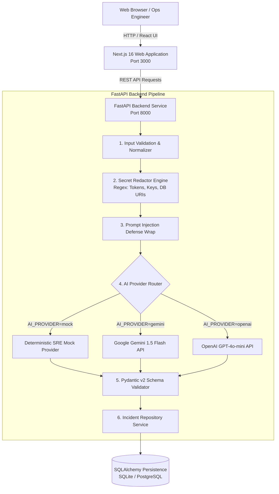
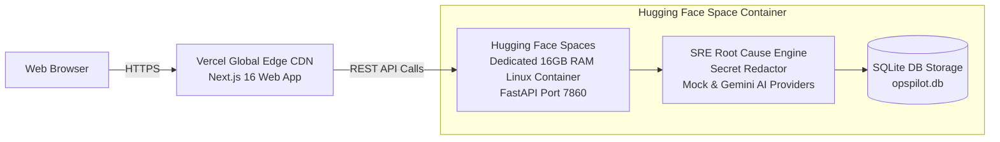

# OpsPilot Architecture & Design Specification

OpsPilot is an AI-powered Site Reliability Engineering (SRE) and incident investigation assistant built with a production-oriented monorepo architecture.

---

## 1. System Topology

---

## 2. Investigation Pipeline Stages

1. **Input Normalization & Limits:**
   - Enforces a maximum character limit (default: 64 KB / 65,536 characters) to prevent memory exhaustion and unbounded context windows.
   - Normalizes line endings (`\r\n` -> `\n`) and rejects whitespace-only or sub-10 character submissions.
2. **Secret & Credential Redaction:**
   - Runs client log text through `SecretRedactor` before sending to any AI provider.
   - Detects and replaces AWS keys (`AKIA...`), GitHub PATs, Bearer tokens, JWT tokens, database connection passwords in URIs, and private RSA/SSH keys with safe redaction markers.
   - Records the total number of scrubbed secrets to report in the UI for compliance auditability.
3. **Prompt Injection Defense:**
   - Raw logs and user inputs are strictly encapsulated as untrusted evidentiary data within delimited tags (`<incident_logs>...</incident_logs>`).
   - The system instructions instruct the model that instructions embedded within logs must be ignored.
4. **AI Provider Layer:**
   - Abstract `BaseAIProvider` decoupling business logic from LLM vendors.
   - **`MockAIProvider`:** Deterministic pattern recognition that identifies standard signatures (PostgreSQL TCP refusal, Kubernetes OOMKilled exit code 137, Docker entrypoint permission failures, ImagePullBackOff, CI test assertion failures, application 500 errors). Quotes actual lines from the log and never hallucinates facts.
   - **`GeminiAIProvider` / `OpenAIAIProvider`:** External providers utilizing structured JSON mode with schema enforcement and automated fallback to mock mode if credentials are absent or remote calls fail.
5. **Schema Validation & Metadata Injection:**
   - Strict Pydantic models validate severity (`low`, `medium`, `high`, `critical`), root cause confidence, evidence array, recommendations with risk levels, prevention items, and honest limitations.
   - Assigns a UUID4 identifier, ISO timestamp, and redacted secret count.
6. **Persistence Layer:**
   - SQLAlchemy repository saves analysis reports and log snippets.
   - Out-of-the-box local zero-config SQLite (`opspilot.db`) with instant PostgreSQL compatibility for production Docker Compose deployments.

---

## 3. Safety Directives & Threat Model

- **No Command Execution:** OpsPilot strictly treats CLI commands as **human-operator suggestions**. The backend does not spawn subprocesses or invoke Docker/Kubernetes/Cloud APIs directly.
- **Server-Side API Key Secrecy:** Provider keys (`GEMINI_API_KEY`, `OPENAI_API_KEY`) reside exclusively in server-side environment variables and are never bundled into client JavaScript.
- **Evidence Grounding:** The model must not invent log lines or claim to have accessed clusters or external monitoring services.

---

## 4. Production Cloud Deployment Architecture

OpsPilot is optimized for zero-cost cloud production hosting:

- **Frontend on Vercel:** Next.js is deployed to Vercel's global CDN for sub-50ms static asset delivery worldwide.
- **Entire Backend on Hugging Face Spaces:** FastAPI, Pydantic, the SRE investigation engine, and SQLite database run inside a dedicated 16 GB RAM container on Hugging Face Spaces.
- **Continuous Integration (GitHub Actions):** Pushing to GitHub triggers `.github/workflows/sync-to-huggingface.yml` to automatically synchronize backend updates to the Hugging Face Space.

