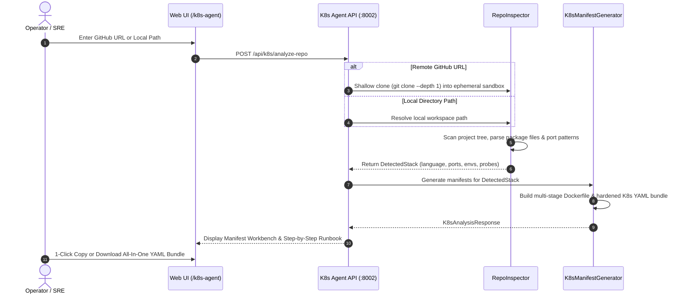
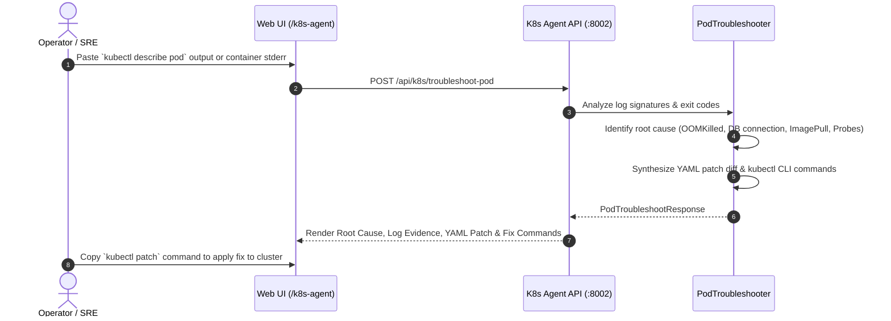

# OpsPilot — Autonomous Kubernetes Agent & DevOps Copilot

The **Kubernetes Agent** (`apps/k8s-agent`) is a standalone, microservice-grade backend engineered to automate the end-to-end lifecycle of containerizing, deploying, and troubleshooting application repositories on Kubernetes.

---

## 1. Executive Summary & Capabilities

OpsPilot's Kubernetes Agent eliminates manual YAML authoring and trial-and-error cluster troubleshooting:
- **Zero-Config Repository Inspection:** Ingests any GitHub URL or local project directory to automatically identify programming languages, application frameworks, exposed TCP/HTTP ports, environment variables, and datastore dependencies.
- **Production-Hardened Manifest Synthesis:** Generates complete, security-compliant Kubernetes manifests (Deployment, Service, ConfigMap, Secret, Ingress, HPA) and optimized multi-stage Dockerfiles without placeholders or generic templates.
- **Automated Pod Lifecycle Diagnostics:** Analyzes container exit codes, Kubernetes events, and `kubectl describe pod` outputs to diagnose failure modes (CrashLoopBackOff, OOMKilled 137, ImagePullBackOff, probe timeouts) and generates drop-in YAML remediation patches.
- **Independent Microservice Architecture:** Runs on its own dedicated port (`8002`), with its own virtual environment (`.venv`), dependencies, and test suite, allowing independent scaling, testing, and container deployment.

---

## 2. Architecture & System Topology

```
┌────────────────────────────────────────────────────────────────────────┐
│                        OpsPilot Web UI (Port 3000)                     │
│               (/k8s-agent - Repository Workbench & Diagnostic Studio)   │
└───────────────────▲────────────────────────────────┬───────────────────┘
                    │                                │
    REST HTTP       │ NEXT_PUBLIC_K8S_API_URL        │ REST HTTP
 (Port 8001)        │ (Port 8002)                    │ (Port 8002)
┌───────────────────┴──────────┐   ┌─────────────────▼───────────────────┐
│       apps/api (8001)        │   │        apps/k8s-agent (8002)        │
│    Incident Log Analyzer     │   │     Autonomous Kubernetes Copilot   │
│   (Redaction, SRE Mock/LLM)  │   │  (Inspector, Generator, Diagnostician)
└──────────────────────────────┘   └─────────────────┬───────────────────┘
                                                     │
                                 ┌───────────────────┴───────────────────┐
                                 │       Local / Cloud Cluster           │
                                 │     (e.g., Kind, Minikube, EKS)       │
                                 └───────────────────────────────────────┘
```

### Module Breakdown (`apps/k8s-agent/app/`)

| Module | File | Purpose |
| :--- | :--- | :--- |
| **API Entrypoint** | [main.py](file:///Users/shaik/Desktop/DevOpsProjects/OpsPilot/apps/k8s-agent/app/main.py) | Initializes FastAPI, mounts CORS middleware (supporting Vercel regex & localhost), mounts `/health` and `/api/k8s` routers. |
| **Configuration** | [core/config.py](file:///Users/shaik/Desktop/DevOpsProjects/OpsPilot/apps/k8s-agent/app/core/config.py) | Dynamic environment loader reading [apps/k8s-agent/.env](file:///Users/shaik/Desktop/DevOpsProjects/OpsPilot/apps/k8s-agent/.env), defaults to Port 8002. |
| **Schemas** | [schemas/k8s.py](file:///Users/shaik/Desktop/DevOpsProjects/OpsPilot/apps/k8s-agent/app/schemas/k8s.py) | Pydantic v2 validation contracts for repo inspection requests, detected stack info, manifests, and pod diagnostics. |
| **Repository Inspector** | [services/inspector.py](file:///Users/shaik/Desktop/DevOpsProjects/OpsPilot/apps/k8s-agent/app/services/inspector.py) | Deep directory scanning, shallow Git cloning, regex port detection, framework heuristic matching. |
| **Manifest Generator** | [services/generator.py](file:///Users/shaik/Desktop/DevOpsProjects/OpsPilot/apps/k8s-agent/app/services/generator.py) | Generates production multi-stage Dockerfiles, Deployment, Service, ConfigMap, Secret, Ingress, HPA, and rollout runbooks. |
| **Pod Troubleshooter** | [services/troubleshooter.py](file:///Users/shaik/Desktop/DevOpsProjects/OpsPilot/apps/k8s-agent/app/services/troubleshooter.py) | Analyzes pod termination logs and events, identifies root causes, and synthesizes YAML patch diffs. |
| **Endpoints** | [api/v1/endpoints/k8s.py](file:///Users/shaik/Desktop/DevOpsProjects/OpsPilot/apps/k8s-agent/app/api/v1/endpoints/k8s.py) | Exposes `/analyze-repo`, `/troubleshoot-pod`, and `/sample-repos`. |

---

## 3. End-to-End Operational Workflow

### Workflow 1: Repository to Production Kubernetes Manifests



### Workflow 2: Automated Pod Lifecycle Troubleshooting



---

## 4. Supported Technologies & Detection Heuristics

The [RepoInspector](file:///Users/shaik/Desktop/DevOpsProjects/OpsPilot/apps/k8s-agent/app/services/inspector.py) automatically identifies the following stacks:

| Ecosystem | Detected Files | Identified Frameworks | Default Port | Generated Base Image |
| :--- | :--- | :--- | :--- | :--- |
| **Python** | `requirements.txt`, `pyproject.toml`, `Pipfile` | FastAPI, Flask, Django, Celery | `8000` | `python:3.12-slim` (Non-root `10001`) |
| **Node.js / TS** | `package.json`, `tsconfig.json` | Next.js (Standalone), Express.js, NestJS, Remix, Fastify | `3000` / `8080` | `node:20-alpine` (Non-root `1001`) |
| **Go** | `go.mod`, `main.go` | Gin, Fiber, Echo, stdlib | `8080` | `scratch` / `alpine:3.20` (CGO_ENABLED=0) |
| **Java / Kotlin** | `pom.xml`, `build.gradle` | Spring Boot, Quarkus | `8080` | `eclipse-temurin:21-jre-alpine` |
| **Rust** | `Cargo.toml` | Actix-web, Axum, Rocket | `8080` | `scratch` (Static musl binary) |
| **Ruby** | `Gemfile` | Ruby on Rails, Sinatra | `3000` | `ruby:3.3-slim` |

---

## 5. Security & Production Hardening Features

All generated Kubernetes manifests comply with enterprise security benchmarks (CIS Kubernetes Benchmark & Pod Security Standards - Restricted):

1. **Non-Root Execution Enforcement:**
   ```yaml
   securityContext:
     runAsNonRoot: true
     runAsUser: 10001
     runAsGroup: 10001
     fsGroup: 10001
     seccompProfile:
       type: RuntimeDefault
   ```
2. **Capability Dropping:** All container Linux capabilities are stripped (`drop: ["ALL"]`).
3. **Multi-AZ Pod Anti-Affinity:** Prevents co-locating all replicas on the same failure domain:
   ```yaml
   topologyKey: topology.kubernetes.io/zone
   ```
4. **Three-Tier Probes (Startup, Readiness, Liveness):**
   - `startupProbe`: Generous initial failure thresholds (up to 60s) to protect slow JVM or build warmups.
   - `readinessProbe`: Isolates unhealthy pods from receiving Ingress traffic.
   - `livenessProbe`: Restarts genuinely deadlocked or hung processes.
5. **HorizontalPodAutoscaler (HPA v2):** Dynamic auto-scaling between 2 and 10 replicas based on 75% CPU and 80% Memory targets.
6. **Automatic Secret Separation:** Extracts credentials into `secret.yaml` with explicit Vault / SealedSecrets integration instructions.

---

## 6. Pod Troubleshooting Scenarios

| Failure Signature | Identified Root Cause | Automated Remediation YAML Patch | Operator Command |
| :--- | :--- | :--- | :--- |
| **OOMKilled (Exit Code 137)** | Container RSS memory exceeded the cgroup memory limit (`resources.limits.memory`). | Boosts memory limits (e.g. to 1.5Gi) and configures runtime heap caps. | `kubectl patch deployment ...` |
| **CrashLoopBackOff (DB Refused)** | Container attempted TCP connection to `127.0.0.1:5432` or before the DB pod was reachable. | Injects `busybox` `initContainers` waiting on DB TCP DNS port + updates `DATABASE_URL`. | `kubectl set env deployment ...` |
| **ImagePullBackOff (Auth 401)** | Kubelet node lacks credentials to authenticate with private registry. | Injects `imagePullSecrets: [{name: regcred}]` into Pod spec. | `kubectl create secret docker-registry ...` |
| **Probe Flapping** | App warmup exceeded `initialDelaySeconds` or probe endpoint returned 500. | Injects `startupProbe` with failureThreshold 30 (150s grace). | `kubectl rollout undo ...` |

---

## 7. API Reference

### `POST /api/k8s/analyze-repo`
Analyzes a repository and generates all production manifests and deployment steps.

**Request Body:**
```json
{
  "repo_source": "local",
  "local_path": "/Users/shaik/Desktop/DevOpsProjects/OpsPilot",
  "app_name": "opspilot-core",
  "namespace": "production",
  "target_port": 8000
}
```

**Response Summary:**
```json
{
  "app_name": "opspilot-core",
  "namespace": "production",
  "detected_stack": {
    "primary_language": "Python",
    "framework": "FastAPI",
    "recommended_port": 8000,
    "health_endpoint": "/health"
  },
  "manifests": {
    "dockerfile": "FROM python:3.12-slim...",
    "deployment_yaml": "apiVersion: apps/v1\nkind: Deployment...",
    "service_yaml": "apiVersion: v1\nkind: Service...",
    "configmap_yaml": "...",
    "secret_yaml": "...",
    "ingress_yaml": "...",
    "hpa_yaml": "...",
    "all_in_one_yaml": "..."
  },
  "deployment_steps": [ ... ]
}
```

### `POST /api/k8s/troubleshoot-pod`
Diagnoses pod failures and generates YAML remediation patches.

**Request Body:**
```json
{
  "pod_name": "auth-service-71b69-pq912",
  "namespace": "production",
  "failure_type": "CrashLoopBackOff",
  "describe_output": "State: Waiting (CrashLoopBackOff)\nLast State: Terminated (Exit Code 1)",
  "pod_logs": "psycopg.OperationalError: connection to server at '127.0.0.1', port 5432 failed: Connection refused"
}
```

---

## 8. Local Development & Testing

### Running the Service:
```bash
cd apps/k8s-agent
source .venv/bin/activate
uvicorn app.main:app --host 0.0.0.0 --port 8002 --reload
```

### Running the Test Suite:
```bash
cd apps/k8s-agent
.venv/bin/pytest -v
```

Interactive OpenAPI Swagger UI is available at **[http://localhost:8002/docs](http://localhost:8002/docs)**.
